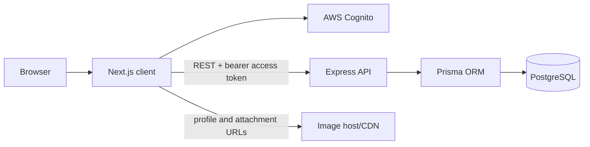

# Project Management

Project Management is a full-stack project and task tracking application. It provides project dashboards, board/list/table/timeline views, priority filters, search, team and user directories, and AWS Cognito sign-in.

## Documentation

- [Architecture](docs/architecture.md)
- [Database](docs/database.md)
- [API reference](docs/api.md)
- [Development workflow](docs/development.md)
- [Contributing](CONTRIBUTING.md)

## Features

- Dashboard with project completion and task-priority charts.
- Projects in board, list, table, and Gantt-timeline views.
- Task creation and status updates.
- Tasks grouped by Urgent, High, Medium, Low, and Backlog priority.
- Cross-entity search for tasks, projects, and users.
- Team and user directories.
- Redux Persist for selected UI state.
- AWS Amplify/Cognito authentication around the Next.js application.

## Technology stack

| Area | Technology |
| --- | --- |
| Web application | Next.js 14 App Router, React 18, TypeScript |
| Styling | Tailwind CSS 3 |
| Client state and API | Redux Toolkit, RTK Query, redux-persist |
| UI components | MUI Data Grid, MUI Material, Lucide React |
| Charts and timelines | Recharts, gantt-task-react |
| API | Node.js, Express 4, TypeScript |
| Database | PostgreSQL, Prisma 5 |
| Authentication | AWS Amplify 6 and Amazon Cognito |
| Security/server middleware | Helmet, CORS, Morgan |
| Process management example | PM2 via `ecosystem.config.js` |

## Architecture overview

The repository is split into independently run `client` and `server` applications.



The Express server does not currently verify Cognito tokens or enforce server-side authorization. The client attaches the current Cognito access token to RTK Query requests, and user identity is obtained with the Cognito subject (`sub`) looked up against the `User.cognitoId` field.

See [Architecture](docs/architecture.md) for component and request details.

## Repository structure

```text
.
├── client/                 Next.js application
│   ├── public/             Static images
│   └── src/
│       ├── app/            App Router pages and dashboard shell
│       ├── components/     Shared UI components
│       ├── lib/            Shared client utilities
│       └── state/          Redux store and RTK Query API
├── server/                 Express and Prisma application
│   ├── prisma/
│   │   ├── migrations/     Versioned SQL migrations
│   │   ├── seedData/       JSON seed records
│   │   ├── schema.prisma   Prisma models
│   │   └── seed.ts         Destructive local seed script
│   └── src/
│       ├── controllers/    Prisma operations
│       ├── routes/         Express route definitions
│       └── index.ts        API entry point
├── docs/                   Architecture and developer documentation
├── .env.example            Safe environment variable template
└── CONTRIBUTING.md         Contribution workflow
```

## Prerequisites

- Node.js 20 or newer is recommended. Both package files use lockfile version 3.
- npm.
- A PostgreSQL database.
- An AWS Cognito User Pool and App Client for sign-in.
- A reachable HTTPS image host/base URL for profile pictures and task attachments.

## Setup

### 1. Clone and install

```bash
git clone <repository-url>
cd project-management-2

npm --prefix client ci
npm --prefix server ci
```

### 2. Configure environment variables

Copy the examples:

```bash
cp server/.env.example server/.env
cp client/.env.example client/.env.local
```

The variables are:

| Variable | Location | Purpose |
| --- | --- | --- |
| `DATABASE_URL` | `server/.env` | PostgreSQL connection string used by Prisma. |
| `PORT` | `server/.env` | Express port; defaults to `3001`. |
| `NEXT_PUBLIC_API_BASE_URL` | `client/.env.local` | API base URL, including the trailing slash if configured in the client. |
| `NEXT_PUBLIC_IMAGE_BASE_URL` | `client/.env.local` | HTTPS base URL used for profile and attachment images. |
| `NEXT_PUBLIC_COGNITO_USER_POOL_ID` | `client/.env.local` | Cognito User Pool ID. |
| `NEXT_PUBLIC_COGNITO_USER_POOL_CLIENT_ID` | `client/.env.local` | Cognito App Client ID. |

Example values and placeholders are documented in [.env.example](.env.example), [server/.env.example](server/.env.example), and [client/.env.example](client/.env.example).

`NEXT_PUBLIC_*` variables are compiled into browser code and must never contain secrets.

### 3. Create and migrate the database

Set `DATABASE_URL` to a PostgreSQL database you own, then run:

```bash
cd server
npx prisma migrate deploy
npm run seed
cd ..
```

The seed command first deletes existing records from all seeded models and then inserts JSON fixtures. Do not run it against production data.

For development schema iteration:

```bash
cd server
npx prisma migrate dev
```

### 4. Start development servers

In separate terminals:

```bash
# Terminal 1
cd server
npm run dev
```

```bash
# Terminal 2
cd client
npm run dev
```

- Client: `http://localhost:3000`
- API: `http://localhost:3001`

Set `NEXT_PUBLIC_API_BASE_URL=http://localhost:3001/` for the default local API. RTK Query appends resource paths without a leading slash in many endpoints.

## Cognito setup and user records

Configure a Cognito User Pool and App Client, then provide their IDs through the three public Cognito/image variables. The client uses the Amplify Authenticator for sign-up and sign-in.

The UI does not call `POST /users` after Cognito sign-up. Therefore a Cognito account is not automatically inserted in the PostgreSQL `User` table. For authenticated user lookup to work, create a matching database user whose `cognitoId` equals the Cognito `sub`, for example through `POST /users`.

## Database

PostgreSQL is the Prisma datasource. The schema contains `User`, `Team`, `Project`, `ProjectTeam`, `Task`, `TaskAssignment`, `Attachment`, and `Comment`. The seed migration and fixtures provide local data.

See [Database design](docs/database.md).

## API

The API is rooted at `/` with resource prefixes `/projects`, `/tasks`, `/search`, `/users`, and `/teams`. The client sends a Cognito bearer access token but the server currently has no middleware that validates it.

See [API reference](docs/api.md).

## Testing

No automated test suite or test script is implemented. The server `npm test` script is a placeholder that exits with an error.

Available verification commands are:

```bash
npm --prefix server run build
npm --prefix client run lint
npm --prefix client run build
```

There are currently no focused unit, integration, end-to-end, or database test commands.

## Production build

```bash
npm --prefix server run build
npm --prefix client run build
```

Run the compiled API:

```bash
cd server
npm start
```

`npm start` rebuilds the server and executes `dist/index.js`. Run the built client from its directory:

```bash
cd client
npm start
```

The API process is configured to listen on `0.0.0.0`; `ecosystem.config.js` is a development-oriented PM2 example that runs `npm run dev` rather than the production build.

## Deployment

No CI/CD workflow or infrastructure-as-code deployment configuration is included. At minimum, deploy:

1. A PostgreSQL database.
2. The Express server with `DATABASE_URL` and `PORT`.
3. The Next.js client with API, image, and Cognito public variables.
4. The image assets/host referenced by `NEXT_PUBLIC_IMAGE_BASE_URL`.

Apply migrations with `npx prisma migrate deploy` before starting the API. Configure Cognito and CORS/origin restrictions before public deployment; the current API uses permissive `cors()` and performs no authorization checks.

## Troubleshooting

| Issue | Check |
| --- | --- |
| `Cannot find module @prisma/client` or Prisma errors | Run `npm ci` in `server`, then `npx prisma generate`. |
| API cannot connect | Confirm `DATABASE_URL`, PostgreSQL availability, and `npx prisma migrate deploy`. |
| Client cannot reach API | Confirm `NEXT_PUBLIC_API_BASE_URL` and the server port; check browser CORS/network logs. |
| Cognito sign-in fails | Confirm pool ID and app-client ID and that the app client is enabled for the selected auth flow. |
| `/users/:sub` returns `null` | Create a database `User` whose `cognitoId` equals the Cognito `sub`. |
| Images do not load | Verify `NEXT_PUBLIC_IMAGE_BASE_URL` is an HTTPS URL and is permitted by `next.config.mjs`. |
| Seed unexpectedly modifies data | Stop and restore from backup; the seed deletes every seeded model before insertion. |

## Contributing

See [CONTRIBUTING.md](CONTRIBUTING.md) for setup, conventions, verification, and pull request expectations.

## License

No root license file or license field for the repository-level project was found. The server package declares `"ISC"`, but this does not establish a license for the complete repository or the client. License clarification is required before redistribution.
