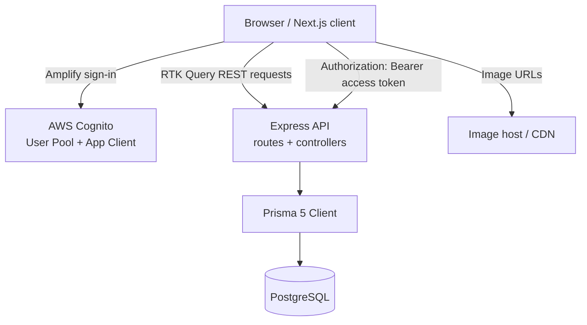
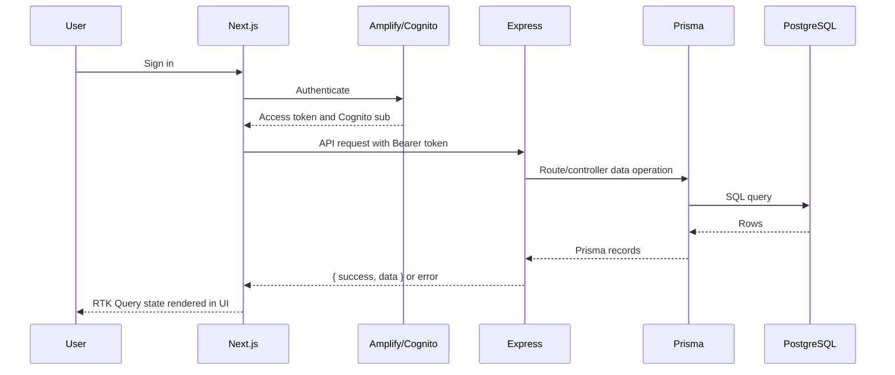

# Architecture

## System overview

Project Management is a two-process web application:

- `client` is a Next.js 14 App Router application that renders the dashboard and calls a REST API.
- `server` is an Express API backed by PostgreSQL through Prisma.
- AWS Cognito provides browser authentication through Amplify.
- `NEXT_PUBLIC_IMAGE_BASE_URL` supplies profile picture and attachment URLs.

## Runtime entry points

### Client

`client/src/app/layout.tsx` is the root layout. It loads global CSS and wraps all pages in `DashboardWrapper`.

`DashboardWrapper` composes:

1. Redux store/provider and persisted global state.
2. AWS Amplify `Authenticator`.
3. The sidebar/navbar dashboard shell.

The global store combines `state` UI settings with the RTK Query API cache. It persists only the `global` slice:

- `isSidebarCollapsed`
- `isDarkMode`
- `lastActiveProjectTab`

### Server

`server/src/index.ts` loads environment variables, creates Express middleware, mounts five route groups, and listens on `PORT` or port `3001`.

Middleware is applied in this order:

1. JSON and URL-encoded body parsing.
2. Helmet and cross-origin resource policy.
3. Morgan common-format request logging.
4. Permissive CORS.

There is no application-level authentication or authorization middleware.

## Component responsibilities

| Component | Responsibility |
| --- | --- |
| `client/src/app` | Next.js routes, dashboard shell, project views, search, settings, users, and teams. |
| `client/src/components` | Shared layout and display components plus create-task/project dialogs. |
| `client/src/state/api.ts` | RTK Query endpoints and shared TypeScript API models. |
| `client/src/state/index.ts` | Redux global UI state. |
| `server/src/routes` | HTTP method and path definitions. |
| `server/src/controllers` | Prisma queries and response/error mapping. |
| `server/prisma/schema.prisma` | Database models and relationships. |
| `server/prisma/seed.ts` | Development fixture cleanup and loading. |

## Request flow

The API does not inspect or validate the bearer token. Cognito is therefore a client-authentication concern in the current implementation, not an established API authorization boundary.

## Authentication and user identity

The browser obtains the Cognito access token and current Cognito user:

- `fetchAuthSession()` supplies the access token attached to RTK Query headers.
- `getCurrentUser()` supplies the Cognito user.
- `session.userSub` is passed to `GET /users/:cognitoId`.
- The returned database user provides the numeric `id` used by priority views.

The sign-up flow does not call `POST /users`; database synchronization is not implemented. A database `User.cognitoId` must match the Cognito `sub` for application user lookup to succeed.

## Data flow

- Project and task mutations invalidate RTK Query tags.
- Project/task/user/team fetches use Redux RTK Query cache entries.
- The global sidebar and theme settings are persisted in browser storage.
- The home dashboard hard-codes project ID `1` when loading chart tasks.
- Search skips API calls until the search term has at least three characters.

## External dependencies

- AWS Cognito for sign-in.
- PostgreSQL for persistence.
- An image host/CDN or Next.js-compatible HTTPS origin for image paths.
- Optional PM2 for the example process configuration.

## Architectural concerns

- The server permits all CORS origins and does not verify bearer tokens.
- There is no server-side validation schema or explicit 400/404 response strategy.
- There is no automatic Cognito-to-PostgreSQL user provisioning.
- The home dashboard is tied to project ID `1`.
- The seed script destructively deletes fixture-model data.
- Automated tests and CI/CD are absent.
- No license for the complete repository has been established.
