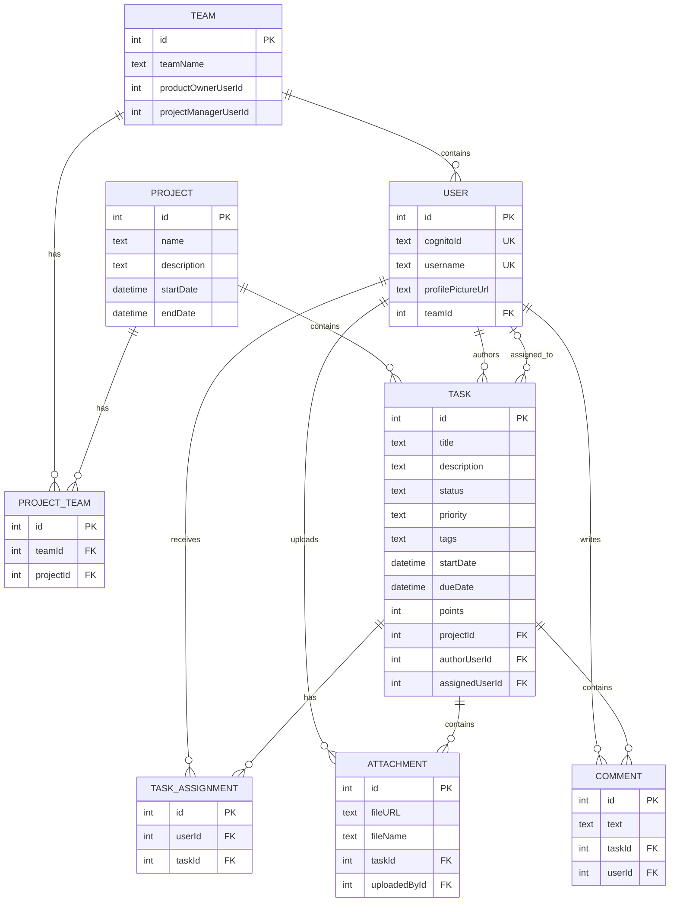

# Database

## Overview

The database is PostgreSQL. Prisma is configured in `server/prisma/schema.prisma` with `DATABASE_URL` as the datasource connection string.

The schema has eight domain models and one join model (`ProjectTeam`). The migration is [20261102032402_init](../server/prisma/migrations/20261102032402_init/migration.sql).



## Models

### User

- `id`: autoincrement primary key.
- `cognitoId`: unique Cognito subject identifier.
- `username`: unique display/login name.
- `profilePictureUrl`: optional relative or external image path.
- `teamId`: optional team relationship.

Users can author and be assigned tasks, upload attachments, write comments, and belong to one team.

### Team

- `teamName`: required team name.
- `productOwnerUserId` and `projectManagerUserId`: optional integer references stored as plain fields, not Prisma foreign-key relations.
- Teams contain users and may participate in projects through `ProjectTeam`.

### Project

- `name` is required.
- `description`, `startDate`, and `endDate` are optional.
- A project owns tasks and project-team links.

### ProjectTeam

Joins projects and teams. It has a required team foreign key and project foreign key. Deleting either linked entity is restricted.

### Task

- `title` is required.
- Project, author, assignee, status, priority, tags, dates, and points are optional except for `projectId` and `authorUserId`.
- Status and priority are free-form strings in Prisma. The client defines known enum values, but the database does not enforce them.
- Tasks have author/assignee relations, assignments, attachments, and comments.

The client status values are `To Do`, `Work In Progress`, `Under Review`, and `Completed`. The priority values are `Urgent`, `High`, `Medium`, `Low`, and `Backlog`.

### TaskAssignment

Many-to-many-style assignment records between users and tasks. There is no unique constraint, so duplicate assignments are permitted unless application logic prevents them.

### Attachment

- `fileURL` is required.
- `fileName` is optional.
- Every attachment belongs to a task and is associated with an uploading user.

### Comment

- `text` is required.
- Every comment belongs to a task and authoring user.

## Foreign keys and delete behavior

| Relationship | Delete behavior |
| --- | --- |
| User team | `SET NULL` on team deletion. |
| ProjectTeam team/project | `RESTRICT`. |
| Task project | `RESTRICT`. |
| Task author | `RESTRICT`. |
| Task assignee | `SET NULL`. |
| TaskAssignment user/task | `RESTRICT`. |
| Attachment task/uploader | `RESTRICT`. |
| Comment task/user | `RESTRICT`. |

Team ownership fields are plain integers and have no foreign-key constraints.

## Migrations

Run all pending migrations:

```bash
cd server
npx prisma migrate deploy
```

Create a migration during local schema development:

```bash
cd server
npx prisma migrate dev --name describe_the_change
```

Review generated SQL before committing it. Inspect migration status with:

```bash
cd server
npx prisma migrate status
```

## Seeding

```bash
cd server
npm run seed
```

The seed script performs this sequence:

1. Deletes records from teams, projects, project teams, users, tasks, attachments, comments, and task assignments.
2. Loads JSON files from `server/prisma/seedData`.

The script is destructive and has no production guard. It should be used only with disposable databases.

## Modeling observations

- Status and priority have no database enums or check constraints.
- `TaskAssignment` duplicates the direct `Task.assignedUserId` relation.
- Team product owner/project manager fields do not have foreign keys.
- Several optional API fields are not consistently validated.
- There are no indexes beyond primary keys and the two unique `User` fields.
